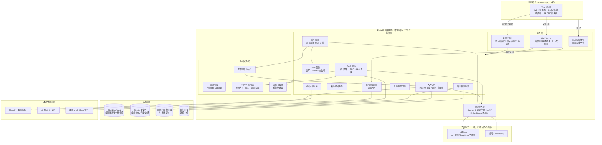
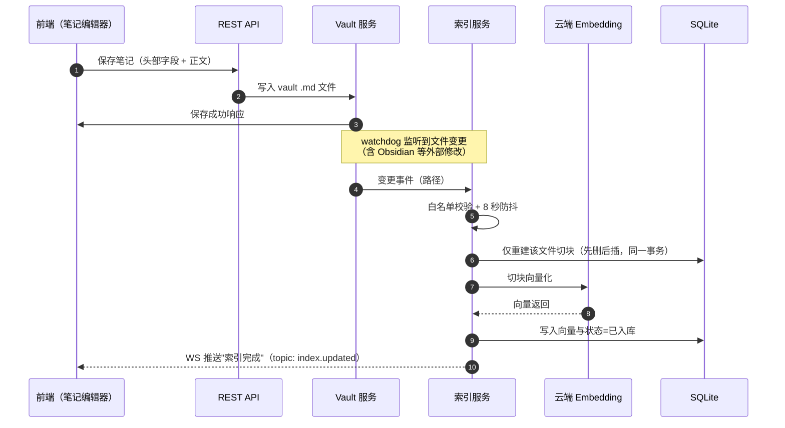
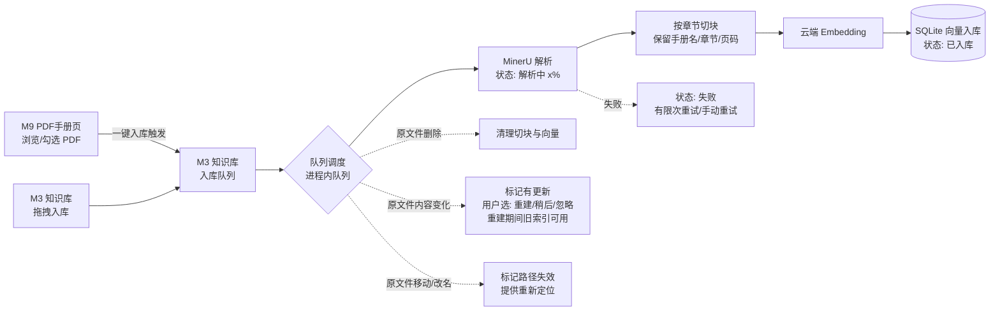
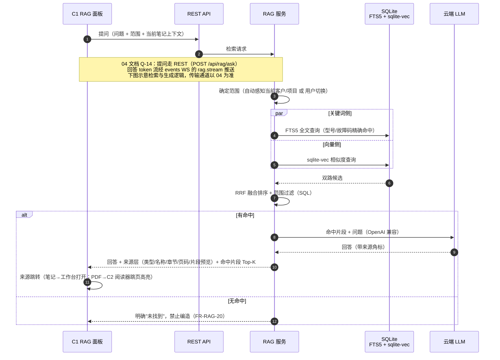
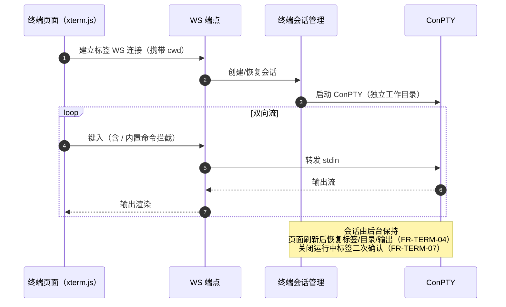
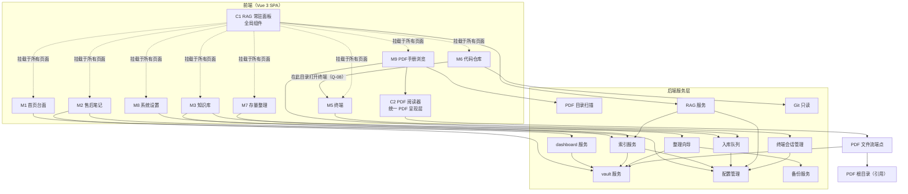

# 02 · 整体架构设计

| 项 | 内容 |
|---|---|
| 文档版本 | v1.1（已定版 · 2026-11-25 评审整改：图表错边修正、过期引用更新） |
| 编制日期 | 2026-11-25 |
| 文档状态 | 二阶段产物；已定版（v1.0 于 2026-11-25 定版，v1.1 为评审整改版） |
| 适用阶段 | 总体设计 · 技术选型与整体架构 |
| 上游依据 | 《01.功能模块梳理.md》v1.0；《项目需求文档.md》v1.1；`prototype/` 交互原型 |
| 范围 | 技术选型、整体架构分层、模块架构映射、项目目录设计、关键决策与风险；**不**展开数据库表结构、API 接口定义，**不**编写代码 |

> 阅读约定：
> - 技术选型中 5 个关键决策（后端框架 / 前端框架 / 数据与向量存储 / RAG 管线 / 实时通信）已于 2026-11-25 与项目所有者逐一交互确认，本文记录结论与依据；
> - 第 8 章列出本阶段新产生的待确认问题（Q-09 ~ Q-11），**未在正文中作为既定事实**；
> - 流程图使用 mermaid 格式。

---

## 1. 设计依据与硬约束

### 1.1 已确认的技术约束（引自需求文档，不重新讨论）

| # | 约束 | 来源 | 对架构的影响 |
|---|---|---|---|
| C1 | HTML 网页 + 本地后台服务；后台仅监听本机回环地址 | 需求 3.1 | 前后端分离部署在同一台机器；无鉴权层；安全依赖回环绑定 |
| C2 | Windows 10+，单用户，无登录 | 需求 3.1 / NFR-COMP-01 | PTY 用 ConPTY；路径分隔符/编码按 Windows 处理 |
| C3 | 云端 LLM，优先兼容 OpenAI 协议，厂商可配置（火山方舟 / DeepSeek / 阿里云百炼等） | 需求 3.2 / FR-CFG-01 | 模型接入层统一抽象为 OpenAI 兼容客户端 |
| C4 | 云端 Embedding（可切换本地，当前云端） | 需求 3.2 / FR-CFG-02 | embedding 客户端同样走 OpenAI 兼容协议抽象 |
| C5 | PDF 解析用 MinerU **本地部署** | 需求 3.2 | 后台以 CLI 子进程方式调度 MinerU（Q-11 已确认，独立安装隔离依赖） |
| C6 | 本地真实 shell（PTY）终端；Git 只读 | 需求 3.2 / FR-TERM / FR-GIT | 后台需要 ConPTY 能力；Git 仅 subprocess 只读 |
| C7 | Obsidian vault 直接读写 + 文件监听 | FR-NOTE | 后台需要文件监听能力；vault 是唯一真相源 |
| C8 | 规模小：笔记 ≤50 篇；手册几十份、单份 ≤500 页；切块向量约 1~5 万条 | OQ-02 / OQ-03 / NFR-PERF-03 | 单机嵌入式存储足够；无分布式需求 |
| C9 | 低维护优先：个人工具不能变成需要长期"养护"的系统 | 需求 1.3-5 | 技术选型以"依赖少、运维零成本"为第一权重 |
| C10 | 每日自动备份工作台自身数据（配置/会话/索引与向量），保留 7 份 | OQ-10 / FR-CFG-09 | 存储方案必须"备份即拷贝"友好 |
| C11 | 后台任务（大文件解析、批量索引）不阻塞界面；后台队列 | NFR-PERF-01 | 需要后台任务队列（进程内队列即可，无需外部队列服务） |

### 1.2 上游设计结论（引自 01.功能模块梳理.md v1.0）

- **10 个一级功能模块 + 2 个常驻组件**：M1 首页台面 / M2 售后笔记 / M3 知识库与 RAG / M4 内置 PDF 阅读器 / M5 终端 / M6 代码仓库 / M7 存量笔记整理 / M8 系统设置 / M9 PDF 手册浏览 + C1 RAG 常驻面板（全局组件）/ C2 PDF 阅读器组件（统一 PDF 呈现层）；
- M3 与 M9 分工：M9 浏览 + 触发入库；M3 队列管理 + 索引状态；
- C2 同时服务 C1 来源跳转与 M9 未入库预览；
- 一期索引白名单为"客户售后问题"文件夹级；二期演进精细粒度（数据结构预留扩展空间）；
- RAG 回答必须可溯源，无依据明确"未找到"。

---

## 2. 技术选型

### 2.1 选型总览

| 层 | 选型 | 状态 |
|---|---|---|
| 后端框架 | **Python 3.11+ / FastAPI** | ✅ 已确认（交互） |
| 前端框架 | **Vue 3 + Vite + TypeScript + Pinia** | ✅ 已确认（交互） |
| 数据库 | **SQLite**（单文件） | ✅ 已确认（交互） |
| 全文检索 | **SQLite FTS5** 扩展 | ✅ 已确认（交互，全 SQLite 方案组成部分） |
| 向量检索 | **SQLite sqlite-vec** 扩展 | ✅ 已确认（交互，全 SQLite 方案组成部分） |
| 缓存 | **进程内缓存**（不引入独立缓存服务） | ✅ 已确认（交互，全 SQLite 方案推论） |
| RAG 管线 | **自写轻量管线**（openai SDK + RRF 融合），不引入 LangChain/LlamaIndex | ✅ 已确认（交互） |
| 实时通信 | **WebSocket 为主**（终端独立 WS + 状态推送共用 WS） | ✅ 已确认（交互） |
| MinerU 集成方式 | **CLI 子进程隔离**（MinerU 独立安装，ingest 服务子进程调用） | ✅ 已确认（交互） |
| Python 依赖管理 | **venv + pip + pyproject.toml**（backend 主环境与 MinerU 独立环境均适用） | ✅ 已确认（交互） |
| 终端前端 | xterm.js | 建议（成熟事实标准） |
| PDF 前端渲染 | pdf.js | 建议（成熟事实标准） |
| Markdown 编辑器 | CodeMirror 6 | 建议（FR-NOTE 自由 Markdown 编辑） |
| 图表 | ECharts | 建议（看板趋势/客户分布） |
| 文件监听 | watchdog（Python） | 建议（Windows 成熟方案） |
| Git 读取 | subprocess 调 git 命令（只读） | 建议（FR-GIT-05 只读，无需 GitPython 重依赖） |
| HTTP 客户端（后端调云端模型） | httpx / openai SDK | 建议（openai SDK 原生兼容火山方舟/DeepSeek/百炼的 OpenAI 兼容模式） |
| 打包与启动 | 一期命令行启动（`run.py`）；三期打包方式另定 | 需求 OQ-05，三期再展开 |

### 2.2 各项选型依据

#### (1) 后端：Python 3.11+ / FastAPI ✅

- **MinerU 同语言**：MinerU 是 Python 生态，后端可直接集成（集成方式见 Q-11），避免跨语言 CLI 封装的脆弱性；
- **RAG 生态最强**：embedding 客户端、文本切块、token 处理等基础件齐备；
- **Windows 关键能力齐备**：ConPTY（pywinpty）、文件监听（watchdog）；
- **FastAPI 特性匹配**：原生 async + WebSocket 支持（FR-TERM 终端与状态推送都需要）；自动 OpenAPI 文档（后续 API 设计阶段的副产品）；Pydantic 配置校验契合 M8 配置管理；
- **规模适配**：单用户本机服务，性能余量充足；
- 落选说明：Node.js（MinerU 仅能 CLI 调用、RAG 生态弱）、C#/.NET（AI 生态弱、MinerU 集成成本高）。

#### (2) 前端：Vue 3 + Vite + TypeScript + Pinia ✅

- **全局常驻面板**（Q-02 结论）+ 跨页面共享状态（RAG 会话、当前上下文、配置）正是组合式 API + Pinia 的核心场景；
- 单文件组件使原型向生产迁移结构清晰；Vite 构建产物由 FastAPI 静态托管，部署简单；
- TypeScript：多模块（10 模块 + 2 组件）长期演进时降低改错成本；
- 中文资料丰富，符合个人低维护诉求；
- 落选说明：React（对本项目无额外收益）、原生 JS（原型已暴露约 300KB 手写字符串模板的可维护性瓶颈）。

#### (3) 存储：全 SQLite（SQLite + FTS5 + sqlite-vec）✅

- **单文件零运维**：无独立数据库服务进程，最贴合 C9 低维护；
- **备份即拷贝**：一个 `.db` 文件 + 一个 `-wal` 文件即全部工作台数据，完美契合 C10（每日备份 7 份）；
- **三类数据一个引擎**：
  - 业务数据（笔记/项目扫描结果、手册记录、入库队列、RAG 会话、Git 仓库记录、配置）→ 普通表；
  - 全文检索（型号/故障码精确命中，FR-RAG-16）→ FTS5；
  - 向量检索（语义命中）→ sqlite-vec；
  - 删除/更新/重建（FR-RAG-10）在一个事务内保证一致性——这是多引擎方案难以廉价做到的；
- **规模适配**：1~5 万条向量，sqlite-vec 毫秒级检索；
- **混合检索实现**：FTS5 关键词查询 + sqlite-vec 向量查询 → RRF（Reciprocal Rank Fusion）融合排序 → SQL 范围过滤；
- 缓存决策：不引入 Redis 等独立缓存服务；看板统计（NFR-PERF-04"缓存 + 增量更新"）用进程内缓存（如带 TTL 的内存字典）实现；
- 落选说明：Chroma（多一个存储引擎与备份对象，与本方案重叠）、FAISS（向量与元数据一致性需自管，删除/更新麻烦）。
- ⚠️ 设计阶段注意事项（非选型问题）：FTS5 默认分词器对中文按字/unicode 处理，中文检索质量需在设计阶段验证 tokenizer 方案（如按字索引 + bigram，或引入 simple 扩展）；embedding 模型切换后向量维度可能变化，需在索引元数据中记录模型标识与维度，切换时提示重建（与 OQ-12"内容更新由用户选择重建"的精神一致）。

#### (4) RAG 管线：自写轻量管线 ✅

- 需求中的 RAG 是**固定管线**（索引 → 切块 → embedding → 混合检索 → 范围过滤 → LLM 生成带引用），无 Agent、无复杂编排——框架的编排价值体现不出来；
- 自写内容：FTS5/vec 双查询 + RRF 融合 + 范围过滤（SQL WHERE）+ 来源组装（切块表天然带手册名/章节/页码，FR-RAG-21 来源层直接可查）；
- 外部依赖仅 `openai` 官方 SDK（火山方舟 / DeepSeek / 阿里云百炼均提供 OpenAI 兼容模式，C3/C4 约束天然满足）；
- 对比模式（FR-RAG-23）：分源检索后按维度对齐输出，属于管线上的输出编排，自写更直接；
- 落选说明：LangChain/LlamaIndex 抽象层重、定制需求（范围过滤/对比模式）需绕过框架、依赖树大、迭代快——与 C9 直接冲突。

#### (5) 实时通信：WebSocket 为主 ✅

- **终端（FR-TERM）**：PTY 字节流双向 → 独立 WS 连接，每标签一条；
- **状态推送**：vault 文件变更（FR-NOTE-06）、入库队列进度（FR-RAG-08）、索引状态、看板增量刷新 → 共用一条 WS，JSON 消息按 topic 区分；
- **双向联动**：RAG 自动感知（FR-RAG-18"当前打开的笔记"）需要前端把上下文变化推给后端，WS 一并覆盖；
- 断线重连、心跳、消息路由只写一套；
- 落选说明：WS+SSE 混合（两套机制并存、SSE 不支持双向联动）；轮询（终端不可行、延迟高）。

### 2.3 前端关键第三方组件（建议，随文档审核确认）

| 组件 | 用途 | 对应需求 |
|---|---|---|
| xterm.js | 终端前端渲染（多标签） | FR-TERM |
| pdf.js | C2 统一 PDF 呈现层（跳页/高亮/多标签/并排） | FR-RAG-24 |
| CodeMirror 6 | 笔记 Markdown 编辑器（头部字段表单 + 正文编辑/预览分栏） | FR-NOTE-04 / 10 |
| ECharts | 看板趋势图 / 客户分布 | FR-DASH-02 / 03 |
| vue-router | 页面路由（10 个模块页面） | M1~M9 |
| Pinia | 全局状态（RAG 面板上下文、会话、配置、当前笔记） | C1 / Q-02 |

---

## 3. 整体架构设计

### 3.1 架构总览

系统采用 **本地单机前后端分离架构**：Vue 3 SPA（构建后由 FastAPI 静态托管）+ FastAPI 后台常驻服务 + SQLite 单文件存储 + 云端模型服务 + 本地 MinerU。全部流量走本机回环地址（C1）。



### 3.2 分层职责

| 层 | 职责 | 不做什么 |
|---|---|---|
| **前端 SPA**（Vue 3） | 页面渲染与交互（M1~M9）、C1 RAG 常驻面板、C2 PDF 阅读器、WS 事件订阅与状态更新、快捷键 | 不直接访问文件系统/数据库；不含业务规则（如待跟进判定） |
| **接入层**（FastAPI 路由） | REST 端点 + WS 端点 + 静态托管；请求校验（Pydantic）；WS 消息路由（topic 分发） | 不含业务逻辑，仅转发与校验 |
| **服务层** | 全部业务规则：白名单判定、8s 防抖、增量索引、入库队列状态机、待跟进判定、冲突检测、整理向导流程、备份调度 | 不直接操作 SQL 细节与外部网络（经基础设施层） |
| **基础设施层** | SQLite 连接/事务/迁移、进程内队列、进程内缓存、配置加载、日志 | 不含业务规则 |
| **模型接入层** | OpenAI 兼容客户端封装（LLM / Embedding 分开配置），厂商可切换（FR-CFG-01/02）；后续可替换为自托管端点（隐私设计要求） | 不做检索逻辑 |
| **存储** | Vault 文件（唯一真相源）、SQLite 单文件（派生数据 + 会话 + 配置）、PDF 根目录（引用不复制）、备份目录 | — |

### 3.3 关键运行时流程

#### (1) 笔记编辑 → 索引 → 可检索（一期核心闭环）



#### (2) PDF 入库队列（本次交付，与核心闭环同步开发）



#### (3) RAG 混合检索与生成



#### (4) 终端会话（三期）



### 3.4 架构级安全与可靠性要点

| 项 | 措施 | 来源 |
|---|---|---|
| 网络边界 | FastAPI 仅绑定 `127.0.0.1`；终端能力仅本机 | NFR-SEC-01 / FR-TERM-08 |
| 密钥 | API Key 仅存本机配置文件（SQLite/配置），后端代理调用云端，前端不回传、不落日志 | NFR-SEC-03 / FR-CFG-08 |
| 隐私告知 | 界面展示数据外传说明（切块→embedding 厂商；片段→LLM 厂商） | NFR-SEC-05 / AC-10 |
| 数据真相源 | vault 文件为唯一真相源；SQLite 中索引/向量/会话为可重建或可丢失数据（会话不重建但可备份） | NFR-DATA-01 |
| 异常恢复 | 重启后索引状态可恢复（依据 vault 重扫 + 队列状态表）；终端会话丢失时全局 toast 提示（Q-07 结论） | NFR-DATA-04 |
| 备份 | 启动时距上次备份 >24h 则补备份；每日备份 SQLite 单文件至备份目录，保留 7 份 | OQ-10 / 5.7 |
| 批量修改保护 | 存量整理写头部前自动备份（备份服务复用），支持一键回滚 | FR-CLEAN-05 / NFR-DATA-02 |
| 冲突 | vault 服务保存前检测 mtime/内容哈希变化，触发前端冲突三选（重载/覆盖/另存） | FR-NOTE-05 |

---

## 4. 模块架构设计

### 4.1 模块 → 架构映射总表

> 期次说明（D13 分期合并，2026-11-25 已确认）：原需求基线 v1.1 的一期（P0）与二期（P1）**合并为本次交付范围**（表中标注"本次"），同步开发、一次性交付；三期（P2）不变。功能范围与需求优先级标注不变，仅排期变更。

| 模块 | 前端落点 | 后端服务 | 存储落点 | 外部依赖 | 期次 |
|---|---|---|---|---|---|
| M1 首页台面 | `views/home` | dashboard 服务（扫描统计 + 缓存） | SQLite 统计缓存 + vault 扫描 | — | 本次（原一期） |
| M2 售后笔记 | `views/notes` + 编辑器组件 | vault 服务 + 索引服务（冲突检测） | vault 文件 + SQLite | watchdog | 本次（原一期） |
| M3 知识库与 RAG | `views/kb` + C1 面板 | 索引服务 + 入库队列 + RAG 服务 | SQLite（FTS5 + sqlite-vec） | 云端 LLM/Embedding + MinerU | 本次（原一期笔记 + 原二期手册） |
| M4/C2 PDF 阅读器 | `reader`（C2 统一组件） | PDF 文件流端点（只读字节流 + 来源元数据查询） | PDF 根目录（引用） | pdf.js | 本次（原二期） |
| M5 终端 | `views/terminal`（xterm.js） | 终端会话管理 | SQLite（标签/目录元数据）+ 后台 PTY | ConPTY | 三期 |
| M6 代码仓库 | `views/repos` | Git 只读服务（定时刷新） | SQLite（仓库记录/置顶状态） | git 命令 | 三期 |
| M7 存量整理 | `views/cleanup` | 整理向导服务（扫描→预览→写入→回滚） | vault 头部字段 + 备份 | 备份服务复用 | 三期 |
| M8 系统设置 | `views/settings` | 配置管理（Pydantic 校验、热生效） | SQLite 配置表 | 云端（测试连接） | 本次（原一期） |
| M9 PDF 手册浏览 | `views/pdf` | PDF 目录扫描 + 入库触发 | SQLite（手册记录/状态） | C2 复用 | 本次（原二期） |
| C1 RAG 常驻面板 | `rag`（全局组件，所有页面挂载） | RAG 服务 + WS 状态订阅 | SQLite（会话） | 同 M3 | 本次（原一期） |

### 4.2 模块依赖关系



### 4.3 关键协作说明

1. **数据源头单向流**：M2 售后笔记（vault 文件）→ vault 服务（监听）→ 索引服务 → SQLite（FTS5/向量）→ RAG 服务 → C1 面板；M1 看板读 vault 扫描结果 + SQLite 统计缓存。保持"vault 唯一真相源，SQLite 为派生"（NFR-DATA-01）。
2. **M9 → M3 协作**（Q-03 结论）：M9 仅做目录扫描、筛选、预览（复用 C2）与入库触发；入库触发后由 M3 的队列服务接管状态机，M9 通过状态筛选展示进度；两模块共享同一份手册状态数据（SQLite），不重复维护。
3. **C2 双模式**（Q-04 结论）：打开已入库 PDF 时携带来源元数据（页码/高亮位置，来自切块表）；打开未入库 PDF 时仅本地预览。C2 不感知调用方，由调用方传入模式参数。
4. **C1 全局上下文**（Q-02 结论）：Pinia 全局 store 保存"当前打开笔记"上下文（客户/项目），RAG 服务据此自动感知检索范围（FR-RAG-18）；上下文变化经 WS 推送后端，保证范围判定在后端一致执行。
5. **配置热生效**：M8 修改 LLM/Embedding/白名单/阈值后由配置管理发布变更事件，索引服务、RAG 服务订阅生效；无需重启后台（FR-CFG-01"无需改代码"精神的延伸）。
6. **备份中心化**：备份服务是唯一备份入口（每日工作台备份 OQ-10 + 整理向导前置备份 FR-CLEAN-05 复用同一机制），避免两套备份逻辑。

---

## 5. 项目目录设计

### 5.1 目录结构（建议）

```text
AkaiRye/
├─ CLAUDE.md                    # 项目协作规则（已有）
├─ 项目需求文档.md               # 需求基线 v1.1（已有）
├─ docs/
│  ├─ design/
│  │  ├─ 01.功能模块梳理.md      # 一阶段产物 v1.0（已定版）
│  │  └─ 02.整体架构设计.md      # 本文档
│  └─ rules/                    # 已确认统一为 docs/rules（Q-09，2026-11-25）
│     ├─ database-rules.md      # 数据库设计规则（已创建）
│     └─ api-rules.md           # API 设计规则（已创建）
├─ prototype/                   # 现有交互原型（保留，作为界面实现参照）
├─ frontend/                    # Vue 3 + Vite + TypeScript 前端
│  ├─ src/
│  │  ├─ api/                   # 后端接口封装：REST 客户端 + WS 客户端（重连/心跳/topic 路由）
│  │  ├─ stores/                # Pinia 全局状态：rag（C1 上下文/会话）、config、editor、ui
│  │  ├─ router/                # 页面路由（M1~M9）
│  │  ├─ views/                 # 页面级组件（与模块一一对应）
│  │  │  ├─ home/               # M1 首页台面（项目列表/看板/快捷入口）
│  │  │  ├─ notes/              # M2 售后笔记列表 + 编辑器（CodeMirror 6）
│  │  │  ├─ kb/                 # M3 知识库（入库队列/索引状态/白名单可视化管理）
│  │  │  ├─ pdf/                # M9 PDF 手册浏览
│  │  │  ├─ terminal/           # M5 终端（xterm.js 多标签）
│  │  │  ├─ repos/              # M6 代码仓库
│  │  │  ├─ cleanup/            # M7 存量整理向导
│  │  │  └─ settings/           # M8 系统设置
│  │  ├─ rag/                   # C1 RAG 常驻面板（全局挂载；对话/来源/片段/对比/会话）
│  │  ├─ reader/                # C2 PDF 阅读器组件（pdf.js；跳页/高亮/多标签/并排）
│  │  ├─ components/            # 通用组件（弹窗/toast/菜单/空态等）
│  │  ├─ utils/                 # 工具函数
│  │  └─ styles/                # 全局样式（可从 prototype/css 迁移精简）
│  ├─ package.json
│  ├─ tsconfig.json
│  └─ vite.config.ts            # 构建输出至 backend/static（由 FastAPI 托管）
├─ backend/                     # FastAPI 后台服务
│  ├─ app/
│  │  ├─ main.py                # 应用入口：路由注册、静态托管、生命周期（启动备份补跑、监听启动）
│  │  ├─ core/                  # 基础设施：配置加载（Pydantic Settings）、日志、路径常量
│  │  ├─ api/                   # REST 路由（按资源域分文件：notes/projects/kb/rag/pdf/terminal/repos/cleanup/settings）
│  │  ├─ ws/                    # WS 端点：terminal（每标签一条）、events（状态推送/上下文联动）
│  │  ├─ services/              # 业务服务（对应第 4 章服务层）
│  │  │  ├─ vault.py            # vault 读写 + watchdog 监听 + 冲突检测
│  │  │  ├─ indexer.py          # 笔记索引：白名单、8s 防抖、增量、FTS5/向量写入
│  │  │  ├─ ingest.py           # PDF 入库队列：状态机、MinerU 调度、切块、向量化
│  │  │  ├─ chunking.py         # 切块策略（笔记/手册章节切块，保留来源信息）
│  │  │  ├─ rag.py              # 混合检索（FTS5 + sqlite-vec + RRF）+ LLM 生成 + 来源组装
│  │  │  ├─ dashboard.py        # 看板统计（进程内缓存 + 增量更新）
│  │  │  ├─ terminal.py         # ConPTY 会话管理（多标签、恢复、关闭保护）
│  │  │  ├─ git_status.py       # Git 只读（subprocess、定期刷新、忽略规则）
│  │  │  ├─ cleanup.py          # 存量整理向导（扫描/预览/写入/回滚）
│  │  │  └─ backup.py           # 每日备份（唯一备份入口）
│  │  ├─ models/                # 数据访问层（表结构在数据库设计阶段确定，本阶段不展开）
│  │  └─ db.py                  # SQLite 连接、事务、FTS5/sqlite-vec 扩展加载、轻量迁移
│  ├─ tests/                    # 后端测试（pytest）
│  ├─ pyproject.toml            # 依赖管理（venv + pip，Q-10 已确认）
│  └─ run.py                    # 一期命令行启动入口（OQ-05）
├─ scripts/                     # 开发/构建辅助脚本（前端构建、启动组合等）
└─ data/                        # 运行时数据（加入 .gitignore）
   ├─ workbench.db              # SQLite 单文件（业务/全文/向量/会话/配置）
   ├─ backups/                  # 每日备份（保留 7 份，位置可在设置中改）
   └─ logs/                     # 后台日志
```

### 5.2 目录设计说明

1. **前后端彻底分离**：`frontend/` 与 `backend/` 平行；前端构建产物输出到后端可托管目录，一期开发期可用 Vite dev server 代理，最终形态由 FastAPI 静态托管（单进程、单端口、仅回环）。
2. **原型 ≠ 生产代码**：`prototype/` 保留不动，作为界面结构与交互的参照；生产前端在 `frontend/` 中按 Vue 组件化重写，样式可从 `prototype/css` 迁移精简。
3. **服务层与服务一一对应**：`backend/app/services/` 下的文件与第 4 章服务层表格一一对应，保证"文档 ↔ 代码"可对照；后续数据库设计与 API 设计也按此边界切分。
4. **数据访问层独立**：`models/` + `db.py` 集中所有 SQL，服务层不写裸 SQL，为后续 database-rules 落地与可能的向量引擎迁移（二期若需换 Chroma）留出隔离层。
5. **运行时数据隔离**：`data/` 独立于代码，整体可备份、可排除出版本库；SQLite 单文件 + 备份目录直接对应 OQ-10。
6. **docs 与 doc 命名冲突**：CLAUDE.md 引用 `doc/rules/database-rules.md`，实际目录为 `docs/`——需统一（待确认问题 Q-09）。

---

## 6. 关键设计决策记录

| # | 决策 | 结论 | 理由摘要 | 状态 |
|---|---|---|---|---|
| D1 | 后端框架 | Python 3.11+ / FastAPI | MinerU 同语言；RAG 生态；pywinpty/watchdog 齐备；原生 WS | ✅ 交互确认 |
| D2 | 前端框架 | Vue 3 + Vite + TS + Pinia | 全局常驻面板与跨页面状态共享；原型迁移结构清晰；低维护 | ✅ 交互确认 |
| D3 | 存储 | 全 SQLite（+FTS5 +sqlite-vec），缓存进程内 | 单文件零运维；备份即拷贝（OQ-10）；删除/更新/重建单事务一致；规模适配 | ✅ 交互确认 |
| D4 | RAG 管线 | 自写轻量管线（openai SDK + RRF） | 固定管线无编排需求；依赖最少；范围过滤/对比模式可控 | ✅ 交互确认 |
| D5 | 实时通信 | WebSocket 为主（终端独立 + 状态共用） | 终端必须双向；断线重连/路由一套；覆盖自动感知双向联动 | ✅ 交互确认 |
| D6 | 模型接入 | 统一 OpenAI 兼容客户端，LLM/Embedding 分开配置 | 需求 3.2；厂商可切换；后续可换自托管（隐私要求） | 需求直接推论 |
| D7 | Git 读取 | subprocess 调 git 只读命令 | FR-GIT-05 只读；避免 GitPython 重依赖 | 建议 |
| D8 | 后台队列 | 进程内任务队列（asyncio） | 规模小；不引入 Redis/Celery 等外部服务（C9） | 建议 |
| D9 | 静态托管 | Vite 构建产物由 FastAPI 托管 | 单进程单端口；部署最简 | 建议 |
| D10 | 备份中心化 | 唯一备份服务覆盖每日备份 + 整理向导前置备份 | 避免两套备份逻辑；OQ-10 与 FR-CLEAN-05 复用 | 建议 |
| D11 | MinerU 集成 | CLI 子进程隔离（独立安装，可独立 venv） | 主进程依赖干净；崩溃隔离；可独立升级；入库为后台任务，子进程开销可接受 | ✅ 交互确认 |
| D12 | 依赖管理 | venv + pip + pyproject.toml | PEP 621 标准；声明式 + 可导出；单人心智负担低；MinerU 独立环境同样适用 | ✅ 交互确认 |
| D13 | 分期合并 | 原一期（P0）+ 原二期（P1）合并为本次交付范围，同步开发、一次性交付；三期（P2）不变；需求基线 v1.1 功能范围与优先级标注不动，仅排期变更 | 手册链路为核心痛点，一次做完工具完整可用；单人项目连续开发减少二次开工成本；架构/数据库/API 一次设计到位。**已明示风险**：MinerU 不确定性可能拖慢整体交付，以并行环境搭建 + 开发启动阶段先行验证缓解 | ✅ 交互确认 |

---

## 7. 潜在风险与缓解

| # | 风险 | 影响 | 缓解 |
|---|---|---|---|
| R1 | **sqlite-vec 相对较新**，Windows 平台扩展加载或版本兼容可能有坑 | 中 | **开发启动第一阶段即验证（spike）**：加载扩展 → 建表 → 插入几万条向量 → 测检索延迟；备选路径：切换 Chroma（models 隔离层已预留，切换成本可控） |
| R2 | **FTS5 中文检索质量**（默认分词对中文不理想），影响型号/故障码与中文关键词命中 | 中 | **与 R1 同时段验证（spike）**：用真实售后笔记（含型号、故障码）测关键词命中率，确定 tokenizer 方案（按字索引/bigram/simple 扩展）；混合检索的向量侧可兜底语义命中 |
| R3 | **MinerU 本地部署门槛**（依赖体积、资源占用、版本兼容）与**扫描版解析质量不稳定**；因 D13 分期合并，该风险升级为**可能影响整体交付节奏** | 中高 | MinerU 环境搭建与业务开发**并行启动**（CLI 子进程隔离，互不阻塞）；开发启动阶段先做部署演练 + 用 1~2 份代表性手册（含扫描版）验证解析质量；ingest 服务内部封装，问题不扩散；最坏情况可按"笔记检索先行、手册入库延后"降级交付 |
| R4 | **embedding 模型切换导致向量维度变化**，旧向量不可用 | 中 | 索引元数据记录模型标识与维度；切换时提示全量重建（与 OQ-12 精神一致）；全库向量 ≤5 万条，重建成本可接受 |
| R5 | **PTY 在 Windows 的稳定性**（ConPTY 版本差异、进程残留） | 中（三期） | 三期排期；会话管理进程树清理；异常丢失已有全局 toast 兜底（Q-07） |
| R6 | **watchdog 在 Windows 的文件事件粒度**（编辑器原子写、临时文件）可能引发误触发/漏触发 | 低中 | 防抖 + 内容哈希去重；白名单过滤临时文件模式（Obsidian 的 .tmp 写入模式） |
| R7 | **功能蔓延**（需求第 11 章已列高风险）；**D13 合并后一期+二期工作量叠加**，交付压力增大 | 高 | 严格按本次交付范围（原一、二期）与三期边界推进；开发计划按里程碑排序（核心闭环功能优先于手册链路功能，保证任何时刻都有可用增量）；三期功能不提前 |
| R8 | **云端调用费用**（索引 + 问答均计费）；手册批量入库为一次性较大开销 | 中 | 8s 防抖 + 仅重建变化文件（OQ-11）；PDF 手动入库（FR-RAG-04）；手册入库按队列分批向量化；片段视图少调用 LLM（FR-RAG-22）；先用笔记链路摸清费用量级 |

---

## 8. 待确认问题闭环（Q-09 ~ Q-11，2026-11-25 交互确认）

### Q-09 · 文档目录命名统一：`doc/` vs `docs/`【已确认】

- **背景**：CLAUDE.md 引用 `doc/rules/database-rules.md` 与 `doc/rules/api-rules.md`；项目实际目录为 `docs/`。
- **确认结论**：**采纳选项 A —— 统一为 `docs/rules/`**，并同步修改 CLAUDE.md 第 3、4 章的两处引用为 `docs/rules/database-rules.md` 与 `docs/rules/api-rules.md`（本次已同步修改）。

### Q-10 · Python 依赖管理工具【已确认】

- **背景**：backend 依赖（fastapi、uvicorn、pywinpty、watchdog、openai、sqlite-vec 等）需要可复现的依赖管理。
- **确认结论**：**采纳选项 A —— venv + pip + pyproject.toml**（PEP 621 标准，声明式依赖 + 可导出 requirements）；backend 主环境与 MinerU 独立环境均采用该方式。

### Q-11 · MinerU 集成方式【已确认】

- **背景**：C5 要求 MinerU 本地部署；MinerU 提供 Python 包与 CLI 两种形态。
- **确认结论**：**采纳选项 A —— CLI 子进程隔离**：
  - MinerU 独立安装（可独立 venv，依赖管理与主环境一致：pyproject.toml + pip）；
  - ingest 服务通过子进程调用 MinerU CLI，将 PDF 解析为 Markdown（含章节结构）落盘；
  - 后台读取 Markdown → 按章节切块 → 云端 embedding → 向量写入 SQLite（FR-RAG-05~07 流程不变）；
  - 解析崩溃不影响后台主服务；MinerU 可独立升级；torch 级重依赖不进入 backend 主环境。

---

## 9. 汇报摘要与下一步

### 9.1 已确认结论（本轮交互）

1. **技术选型五项核心决策**全部确认：Python 3.11+ / FastAPI（后端）、Vue 3 + Vite + TS + Pinia（前端）、全 SQLite 方案（SQLite + FTS5 + sqlite-vec + 进程内缓存）、自写轻量 RAG 管线（openai SDK + RRF）、WebSocket 为主（终端独立 WS + 状态推送共用 WS）。
2. **本阶段新增三项决策**确认：MinerU 以 CLI 子进程隔离集成（Q-11）、依赖管理统一 venv + pip + pyproject.toml（Q-10）、规则文件统一落位 `docs/rules/` 并同步修正 CLAUDE.md 引用（Q-09，已修改）。
3. **分期合并（D13）确认**：原一期（P0）+ 原二期（P1）合并为本次交付范围，MinerU 手册链路与核心闭环同步开发、一次性交付；三期（P2）不变；需求基线 v1.1 功能范围与优先级标注不动，仅排期变更。
4. **整体架构**：本地单机前后端分离（SPA + FastAPI 常驻 + SQLite 单文件 + 云端模型 + 本地 MinerU），五层职责：前端 SPA / 接入层 / 服务层 / 基础设施层 / 模型接入层；四条关键运行时流程（笔记索引、PDF 入库、RAG 问答、终端会话）已用 mermaid 表达。
5. **模块架构**：10 模块 + 2 组件全部映射到前端页面/组件与后端服务，依赖关系与协作规则（M9↔M3 分工、C2 双模式、C1 全局上下文、配置热生效、备份中心化）已明确。
6. **项目目录**：`frontend/` + `backend/` 前后端分离；服务层文件与模块梳理一一对应；`data/` 运行时数据隔离；`prototype/` 保留为参照。

### 9.2 开发启动阶段的验证清单（随 D13 合并，全部前置）

| # | 验证项 | 性质 | 时机 |
|---|---|---|---|
| V1 | sqlite-vec 在 Windows 的加载与检索（R1 spike） | 技术验证 | 开发启动第一阶段 |
| V2 | FTS5 中文 tokenizer 方案与命中率（R2 spike） | 技术验证 | 与 V1 同时段 |
| V3 | MinerU 独立环境部署演练 + 1~2 份代表性手册（含扫描版）解析质量验证（R3） | 环境验证 | 与业务开发并行启动 |

### 9.3 下一步

1. 项目所有者已审核本文档，v1.0 于 2026-11-25 定版（v1.1 为评审整改版，见《05.设计方案评审结果.md》）；
2. 已作为三、四阶段输入，完成数据库设计与 API 设计；
3. 后续制定开发计划时，按 9.2 验证清单先行，并保证核心闭环功能优先交付（任何时刻都有可用增量）。

---

*本文档由 2026-11-25 技术选型与整体架构设计整理而成；技术选型五项决策与项目所有者逐一交互确认；依据为《01.功能模块梳理.md》v1.0、《项目需求文档.md》v1.1 与 `prototype/` 原型。*
