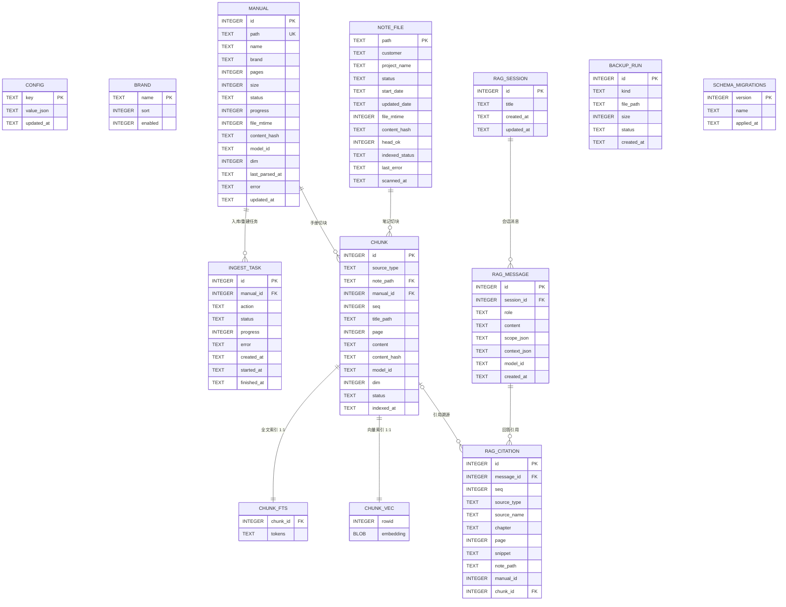

# 03 · 数据库设计

| 项 | 内容 |
|---|---|
| 文档版本 | v1.1（已定版 · 2026-11-25 评审整改：Q-15 manual 状态机新增 discovered） |
| 编制日期 | 2026-11-25 |
| 文档状态 | 三阶段产物；已定版（v1.0 于 2026-11-25 定版，v1.1 为评审整改版） |
| 适用阶段 | 数据库设计 |
| 上游依据 | 《01.功能模块梳理.md》v1.0；《02.整体架构设计.md》v1.0（D1~D13）；《项目需求文档.md》v1.1 |
| 遵循规则 | 《docs/rules/database-rules.md》（本设计同步创建，2026-11-25） |
| 范围 | 本次交付范围（原一期 + 二期，D13）全部模块的表结构、FTS5/向量表一致性方案、迁移与备份；**不**含 API 接口定义；三期表仅预留说明（Q-12 结论） |

---

## 1. 设计原则（摘要，全文见 database-rules.md）

1. **vault 唯一真相源**：`note_file`、`chunk` 等 vault 相关表均为可重建派生数据，支持删库重建（NFR-DATA-01）；
2. **三件套同事务**：`chunk` / `chunk_fts` / `chunk_vec` 必须同一事务写入与删除（FR-RAG-10、OQ-12 落地基础）；
3. **禁止级联删除**：删除动作由服务层显式事务执行；
4. 命名 snake_case、表名单数、时间 ISO 8601 UTC TEXT、业务日期 `YYYY-MM-DD`、枚举 TEXT + CHECK、JSON 列以 `_json` 结尾；
5. 规模基线（切块 ≤5 万）内优先简单性。

---

## 2. ER 总览



> `chunk_fts` 与 `chunk_vec` 为虚拟表（FTS5 / sqlite-vec），与 `chunk` 以 rowid/chunk_id 一一对应，均在同一事务维护；ER 图中以实体形式示意。

---

## 3. 表结构详细定义

### 3.1 配置分组

#### `config` —— 工作台配置（M8）

| 列 | 类型 | 约束 | 说明 |
|---|---|---|---|
| key | TEXT | PRIMARY KEY | 配置键，命名空间前缀分组（`llm.` / `embedding.` / `paths.` / `index.` / `dashboard.` / `backup.` / `shortcuts.`） |
| value_json | TEXT | NOT NULL | 配置值（JSON） |
| updated_at | TEXT | NOT NULL | 最近修改时间（ISO 8601 UTC） |

**预置键（语义定义，非建表内容）**：

| key | value_json 内容 | 对应需求 |
|---|---|---|
| `llm` | `{provider, base_url, api_key, model, temperature}` | FR-CFG-01 |
| `embedding` | `{mode(cloud/local), provider, api_key, model, dim}` | FR-CFG-02 |
| `paths` | `{vault_root, notes_folder, pdf_root, code_roots[1..3]}` | FR-CFG-03 |
| `index.whitelist` | `{folders: ["客户售后问题"]}`（一期文件夹级；字段结构预留二期 folders/files/excluded 扩展，Q-05） | FR-RAG-02 / FR-CFG-04 |
| `dashboard` | `{follow_up_days: 7, default_range: "month"}` | FR-CFG-06 / FR-DASH-05 |
| `backup` | `{dir, keep: 7}` | FR-CFG-09 |
| `shortcuts` | `{global_ask, new_note, terminal, send}` | FR-CFG-10 / OQ-09 |
| `privacy.ack` | `{acknowledged: true}`（数据外传说明确认） | NFR-SEC-05 / AC-10 |

- API Key 存于本表（`llm.api_key` / `embedding.api_key`），按规则第 8 节脱敏后才能出后端；
- 配置热生效：服务层写入后发布进程内变更事件（02 文档 4.3-5），无需重启。

#### `brand` —— 品牌枚举（FR-RAG-13 / FR-CFG-05）

| 列 | 类型 | 约束 | 说明 |
|---|---|---|---|
| name | TEXT | PRIMARY KEY | 品牌名（高创 / ACS / Agito …，可新增） |
| sort | INTEGER | NOT NULL DEFAULT 0 | 展示排序 |
| enabled | INTEGER | NOT NULL DEFAULT 1 | 是否启用 |

- 预置：高创、ACS、Agito；不做自由文本输入（FR-RAG-13）。

### 3.2 vault 派生分组

#### `note_file` —— 售后笔记扫描缓存（M1 / M2 / M3 检索范围依据）

| 列 | 类型 | 约束 | 说明 |
|---|---|---|---|
| path | TEXT | PRIMARY KEY | vault 内相对路径（唯一真相锚点） |
| customer | TEXT | | 客户（frontmatter `name`，OQ-06；可空=未识别，整理向导目标） |
| project_name | TEXT | | 项目名（头部字段；可空） |
| status | TEXT | CHECK('active','archived') | 项目状态（FR-NOTE-09） |
| start_date | TEXT | | 开始日期（YYYY-MM-DD，可空） |
| updated_date | TEXT | | 最近更新（YYYY-MM-DD，头部字段 + 文件 mtime 辅助） |
| file_mtime | INTEGER | | 文件修改时间（unix 秒，变更检测） |
| content_hash | TEXT | | 内容哈希（watchdog 误触发去重、R6） |
| head_ok | INTEGER | NOT NULL DEFAULT 0 | 头部字段是否完整（整理向导扫描目标，FR-CLEAN-01） |
| indexed_status | TEXT | CHECK('ready','pending','failed','excluded') | 索引状态（excluded=不在白名单，FR-RAG-02） |
| last_error | TEXT | | 最近索引错误（失败可见可重试，FR-RAG-03） |
| note_title | TEXT | | 列表标题：正文首个 H1 → 头部 `title`（纯日期占位跳过）→ 文件名（v2） |
| summary | TEXT | | 列表摘要：头部 `description` → 正文首段有效文本，截断 80 字（v2） |
| tags | TEXT | | 标签，逗号分隔；兼容 YAML 列表与 `[a, b]` 内联写法（v2） |
| note_mode | TEXT | CHECK('project','card') | 项目笔记 / 按日期售后卡片：有 `project` 或 `start_date` 视为 project（v2） |
| scanned_at | TEXT | NOT NULL | 最近扫描时间 |

- **派生属性**：整表可由 vault 全量重扫重建；项目列表（FR-PROJ-01/02）与看板统计（FR-DASH-07）均由此表查询 + 进程内缓存（NFR-PERF-04）；
- 待跟进判定（FR-DASH-06：active 且 updated_date 距今 > N 天）在查询层计算，不入库。
- **v2 卡片兼容口径**（迁移 `note_file_display_fields`）：真实 vault 的售后记录是「按日卡片」（`75 Journal/售后卡片/20260818.md`），头部只有 `name/time/tags/description/title`，没有 `project/status/start_date`。因此：
  - `head_ok` 按模式判定——卡片只要求 `name`，项目笔记仍要求 `name/project/status/start_date/updated`，避免真实卡片被整片标成「缺头」；
  - 缺 `status` 的卡片一律按 `active` 统计，归档时由服务层补写 `status` 键（不要求先跑存量整理）；
  - `note_title`/`summary`/`tags`/`note_mode` 仅服务列表展示与看板显示名，不构成第二份真相源。

**索引**：`(status)`、`(customer)`、`(indexed_status)`。

### 3.3 手册与队列分组

#### `manual` —— 手册记录（M3 / M9，派生数据，引用原路径）

> **Q-15 结论（2026-11-25 评审确认）**：扫描发现的 PDF 一律建 `manual` 行（初始 `status='discovered'`），即本表为 pdf_root 的全量镜像（派生，可由重扫重建）；所有 PDF 统一以 `id` 供 M3/M9/C2 访问。

| 列 | 类型 | 约束 | 说明 |
|---|---|---|---|
| id | INTEGER | PRIMARY KEY | |
| path | TEXT | UNIQUE NOT NULL | PDF 原路径（引用不复制，FR-RAG-09） |
| name | TEXT | NOT NULL | 手册名（文件名） |
| brand | TEXT | | 品牌（路径/文件名自动识别，FR-RAG-12；空=未知） |
| pages | INTEGER | | 页数（解析后回填） |
| size | INTEGER | | 文件大小 |
| status | TEXT | CHECK('discovered','queue','parsing','rebuilding','ready','failed','update','invalid') NOT NULL | 入库状态（FR-RAG-08；discovered=扫描发现未入库，Q-15；invalid=路径失效） |
| progress | INTEGER | | 解析/重建进度 0~100 |
| file_mtime | INTEGER | | 原文件修改时间（"有更新"检测，FR-RAG-10） |
| content_hash | TEXT | | 解析时内容哈希 |
| model_id | TEXT | | 生成向量所用 embedding 模型标识（R4） |
| dim | INTEGER | | 向量维度（R4） |
| last_parsed_at | TEXT | | 最近解析时间 |
| error | TEXT | | 最近错误 |
| updated_at | TEXT | NOT NULL | |

**索引**：`(status)`、`(brand)`。

#### `ingest_task` —— 入库队列任务（FR-RAG-08）

| 列 | 类型 | 约束 | 说明 |
|---|---|---|---|
| id | INTEGER | PRIMARY KEY | |
| manual_id | INTEGER | REFERENCES manual(id) NOT NULL | 目标手册 |
| action | TEXT | CHECK('ingest','rebuild','relocate','remove') | 任务类型 |
| status | TEXT | CHECK('queued','running','done','failed','canceled') NOT NULL | 任务状态 |
| progress | INTEGER | | 进度 0~100 |
| error | TEXT | | 错误信息 |
| created_at | TEXT | NOT NULL | 入队时间（排队序） |
| started_at | TEXT | | |
| finished_at | TEXT | | |

- 队列执行由进程内任务队列（D8）调度，本表为队列状态持久化——后台重启后依据 `queued/running` 任务恢复（NFR-DATA-04）；
- 排队顺序按 `created_at`。

**索引**：`(status, created_at)`、`(manual_id)`。

### 3.4 切块与检索分组（核心，三件套同事务）

#### `chunk` —— 切块主表（笔记 + 手册共用）

| 列 | 类型 | 约束 | 说明 |
|---|---|---|---|
| id | INTEGER | PRIMARY KEY | |
| source_type | TEXT | CHECK('note','manual') NOT NULL | 来源类型 |
| note_path | TEXT | REFERENCES note_file(path) | 笔记来源路径（note 时必填） |
| manual_id | INTEGER | REFERENCES manual(id) | 手册来源（manual 时必填） |
| seq | INTEGER | NOT NULL | 块序（源内递增） |
| title_path | TEXT | | 章节标题层级（手册，FR-RAG-06）/ 日期小节标题（笔记） |
| page | INTEGER | | 手册页码（FR-RAG-21 来源层、FR-RAG-24 跳页；笔记为空） |
| content | TEXT | NOT NULL | 块原文 |
| content_hash | TEXT | NOT NULL | 块哈希（增量去重） |
| model_id | TEXT | NOT NULL | 向量模型标识（R4 校验） |
| dim | INTEGER | NOT NULL | 向量维度 |
| status | TEXT | CHECK('ready','rebuilding') NOT NULL DEFAULT 'ready' | ready=检索可见；rebuilding=重建中（OQ-12 旧索引可用） |
| indexed_at | TEXT | NOT NULL | 入库时间 |

**来源一致性 CHECK**：
- `source_type='note'` → `note_path IS NOT NULL AND manual_id IS NULL AND page IS NULL`
- `source_type='manual'` → `manual_id IS NOT NULL AND note_path IS NULL`

**索引**：`(note_path)`、`(manual_id)`、`(status)`、`(source_type)`。

#### `chunk_fts` —— FTS5 全文索引（关键词侧，FR-RAG-16）

```sql
CREATE VIRTUAL TABLE chunk_fts USING fts5(
    tokens,              -- 应用层分词后的文本（database-rules 第 10 节：默认 bigram）
    chunk_id UNINDEXED
);
```

- **非 external content 表**：因分词文本 ≠ 原文，`tokens` 由服务层写入（bigram + ASCII 串保持原样）；
- 与 `chunk` 同事务插入/删除；查询：FTS 命中 `chunk_id` → 回表 `chunk`；
- 分词方案切换（V2 spike 后）仅需重建本表（规则第 10 节）。

#### `chunk_vec` —— sqlite-vec 向量索引（语义侧）

```sql
CREATE VIRTUAL TABLE chunk_vec USING vec0(
    embedding float[1024]   -- 维度 = 首次建库时 embedding.dim；变更需全量重建（规则第 9.4 节）
);
```

- rowid = `chunk.id`；与 `chunk` 同事务插入/删除；
- KNN 查询 → rowid 回表 `chunk` → SQL 范围过滤（规则第 11.3 节，规模内后过滤足够）；
- 维度示例 1024，以实际配置的 embedding 模型为准；`chunk.model_id/dim` 与当前配置不一致时检索提示重建（R4）。

#### 三件套事务示例（服务层伪流程，非 SQL 展开）

```
写入一块：BEGIN → INSERT chunk → INSERT chunk_fts → INSERT chunk_vec(rowid=chunk.id) → COMMIT
删除一批：BEGIN → DELETE chunk_fts/vec (by chunk_id) → DELETE chunk → COMMIT
手册重建完成：BEGIN → DELETE 旧 ready 块三件套 → UPDATE 新块 rebuilding→ready → UPDATE manual.status='ready' → COMMIT
```

### 3.5 RAG 会话分组（OQ-08：永久保留至手动删除）

#### `rag_session` —— 会话（FR-RAG-25）

| 列 | 类型 | 约束 | 说明 |
|---|---|---|---|
| id | INTEGER | PRIMARY KEY | |
| title | TEXT | NOT NULL | 会话名（可重命名） |
| created_at | TEXT | NOT NULL | |
| updated_at | TEXT | NOT NULL | 最近问答时间（会话列表排序） |

#### `rag_message` —— 会话消息

| 列 | 类型 | 约束 | 说明 |
|---|---|---|---|
| id | INTEGER | PRIMARY KEY | |
| session_id | INTEGER | REFERENCES rag_session(id) NOT NULL | 所属会话 |
| role | TEXT | CHECK('user','assistant') NOT NULL | |
| content | TEXT | NOT NULL | 消息文本（Markdown） |
| scope_json | TEXT | | 检索范围快照（FR-RAG-17/18，回放用） |
| context_json | TEXT | | 当时自动感知上下文（客户/项目） |
| model_id | TEXT | | 生成所用 LLM |
| created_at | TEXT | NOT NULL | |

**索引**：`(session_id, created_at)`。

#### `rag_citation` —— 来源引用（Q-13 结论：独立表）

| 列 | 类型 | 约束 | 说明 |
|---|---|---|---|
| id | INTEGER | PRIMARY KEY | |
| message_id | INTEGER | REFERENCES rag_message(id) NOT NULL | 所属回答 |
| seq | INTEGER | NOT NULL | 角标序号 |
| source_type | TEXT | CHECK('note','manual') NOT NULL | 来源类型（FR-RAG-21） |
| source_name | TEXT | NOT NULL | 名称（笔记标题/手册名） |
| chapter | TEXT | | 章节（手册）或日期小节（笔记） |
| page | INTEGER | | 手册页码（FR-RAG-24 跳页） |
| snippet | TEXT | NOT NULL | 片段预览（FR-RAG-21 可展开） |
| note_path | TEXT | | 笔记跳转路径 |
| manual_id | INTEGER | | 手册跳转目标 |
| chunk_id | INTEGER | REFERENCES chunk(id) | 溯源切块（Q-13：可检测断链） |

**索引**：`(message_id, seq)`、`(chunk_id)`。

- 删除会话：服务层单事务 `DELETE citation → DELETE message → DELETE session`（规则第 3.2 条禁级联）；
- 手册删除/索引重建后，引用中的 `chunk_id` 可能失效——来源层展示以 `source_name/chapter/page/snippet` 冗余字段为准（不受断链影响），`chunk_id` 仅作溯源关联；跳转手册前校验 `manual.status`。

### 3.6 备份分组

#### `backup_run` —— 备份记录（OQ-10 / 规则第 7 节）

| 列 | 类型 | 约束 | 说明 |
|---|---|---|---|
| id | INTEGER | PRIMARY KEY | |
| kind | TEXT | CHECK('daily','cleanup_rollback') NOT NULL | 备份类型（三期整理回滚复用） |
| file_path | TEXT | NOT NULL | 备份文件路径 |
| size | INTEGER | | 文件大小 |
| status | TEXT | CHECK('ok','failed') NOT NULL | |
| created_at | TEXT | NOT NULL | 启动补跑判断依据（>24h） |

### 3.7 迁移

#### `schema_migrations`

| 列 | 类型 | 约束 |
|---|---|---|
| version | INTEGER | PRIMARY KEY |
| name | TEXT | NOT NULL |
| applied_at | TEXT | NOT NULL |

---

## 4. 核心一致性场景（需求 ↔ 数据库操作对照）

| 场景 | 需求 | 数据库操作（均服务层事务） |
|---|---|---|
| PDF 根目录扫描发现新文件 | FR-RAG-11 / M9 | 建 `manual` 行，status='discovered'（Q-15）；文件被删除且无切块 → 删行 |
| 笔记保存 8s 后增量 | FR-RAG-03 / OQ-11 | 重扫该文件 → hash 变化 → 事务删除旧块三件套 → 插入新块三件套 → 更新 note_file |
| 笔记移出白名单 | FR-RAG-02 | 事务删除其全部块三件套；note_file.indexed_status='excluded' |
| 手册入库成功 | FR-RAG-05~08 | 逐批（100 块/事务）写三件套 → 最终事务置 manual.status='ready' |
| 手册内容变化 | FR-RAG-10 / OQ-12 | file_mtime/hash 比对 → manual.status='update' → 用户选重建：新块 rebuilding 写入（旧 ready 保留）→ 完成事务换标；选忽略：清除 update 标记 |
| 手册删除 | FR-RAG-10 / OQ-12 | 事务删除全部块三件套 + manual 行 |
| 手册移动/改名 | FR-RAG-10 | 仅 manual.status='invalid'（块保留），重新定位后更新 path 置回 ready |
| 删除会话 | FR-RAG-25 / OQ-08 | 事务 citation → message → session |
| 一键清空全部会话 | FR-RAG-25 | 同上，全表按序 |
| 后台异常恢复 | NFR-DATA-04 | 重启：running/queued 任务重置为 queued 重跑；chunk.rebuilding 块清理；索引依据 note_file.scan 重扫校正 |

---

## 5. 迁移与部署

1. 启动序列（`main.py` 生命周期）：执行未应用迁移 → PRAGMA foreign_keys=ON/WAL → 判断补备份（backup_run >24h）→ 启动 watchdog 与队列恢复；
2. 一期初始迁移 `m001_init.sql` 建全部本阶段表；FTS5/sqlite-vec 扩展加载失败即启动失败（V1 spike 前置验证，R1）；
3. embedding 维度在 `m001` 建库时依据当时配置确定；后续维度变更不修改虚拟表定义，走"清空重建"流程（规则第 9.4 节）。

## 6. 三期表预留说明（Q-12 结论：本阶段不建表）

| 三期模块 | 预期表（届时设计） | 依赖的实现输入 |
|---|---|---|
| M5 终端 | `terminal_tab`（标签、cwd、会话元数据） | PTY 恢复策略（FR-TERM-04） |
| M6 仓库 | `repo_record`（路径、置顶/隐藏、状态摘要缓存） | Git 扫描实现（FR-GIT） |
| M7 整理 | `cleanup_batch` / `cleanup_item`（批次、预览建议、执行与回滚） | 整理向导实现（FR-CLEAN） |

`schema_migrations` 机制支持届时平滑加表。

> **M5 已落位（2026-11-27）**：`terminal_tab` 表经迁移 v4 创建，结构如下：
>
> ```sql
> CREATE TABLE terminal_tab (
>     tab_id     TEXT PRIMARY KEY,          -- 标签唯一标识
>     cwd        TEXT NOT NULL,             -- 独立工作目录（FR-TERM-05）
>     title      TEXT NOT NULL,             -- 标签标题（默认取目录名）
>     sort       INTEGER NOT NULL DEFAULT 0,-- 标签排序
>     created_at TEXT NOT NULL              -- ISO 8601 UTC
> );
> ```
>
> 说明：PTY 进程随标签常驻但**仅内存维护**（不落库），重启后标签仍可恢复，
> 重新附着时按 cwd 重启 shell，输出历史按 NFR-DATA-04「终端会话允许丢失」处理。

---

## 7. 待确认问题

本阶段交互已确认：**Q-12** 表范围（本次交付范围建表，三期表三期前补充设计）；**Q-13** 引用存储（独立 `rag_citation` 表）。其余设计决策（时间格式、bigram 分词默认、配置 key-value、禁止级联删除等）均为 database-rules.md 规则条目，依据已在规则中写明，随文档一并审核。

---

## 8. 汇报摘要与下一步

### 8.1 主要设计结论

1. **12 张表**：`config`、`brand`、`note_file`、`manual`、`ingest_task`、`chunk`、`chunk_fts`（FTS5）、`chunk_vec`（sqlite-vec）、`rag_session`、`rag_message`、`rag_citation`、`backup_run` + `schema_migrations`；三期表不建，仅预留说明；
2. **三件套同事务**：chunk / FTS / 向量一致写入与删除，是 FR-RAG-10 与 OQ-12 的落地基础；重建用 `status='rebuilding'` 保证旧索引可用；
3. **vault 派生可重建**：note_file / manual / chunk 全部支持依据真相源重建；会话与配置为备份保护对象；
4. **需求逐条落库**：待跟进阈值查询层计算、品牌枚举独立表、引用独立表含 chunk_id 溯源、备份记录表支持 24h 补跑判断；
5. 遵循 `docs/rules/database-rules.md`（本次同步创建）。

### 8.2 下一步

1. 请审核本文档 v0.1 与 `docs/rules/database-rules.md`；
2. 审核通过后两文档定版，进入 **API 设计**阶段（遵循 `docs/rules/api-rules.md`，届时同步创建该规则文件）；
3. V1/V2/V3 三个 spike（sqlite-vec、FTS5 中文、MinerU 部署）建议在开发启动阶段先行，其结论可能微调 FTS 分词与维度策略（均有平滑迁移路径）。
